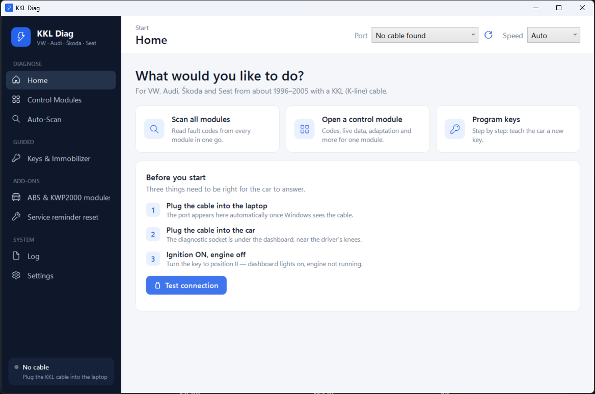
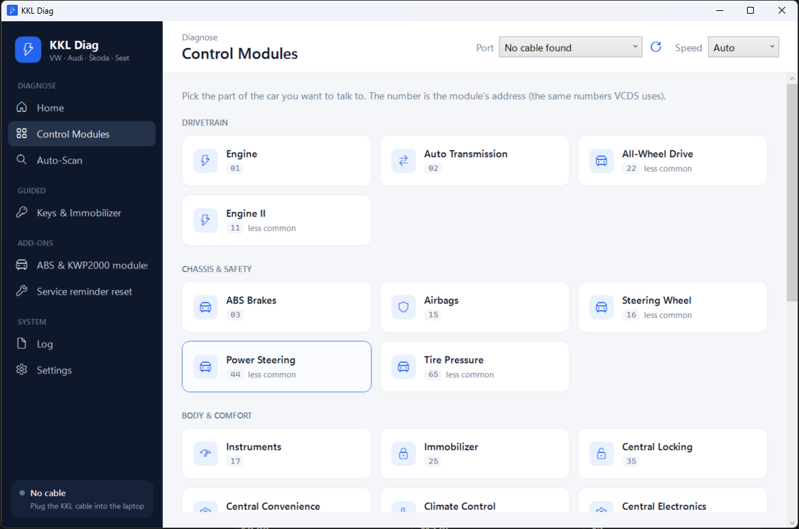
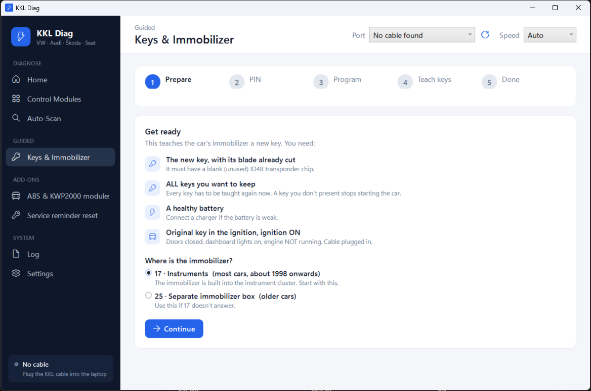
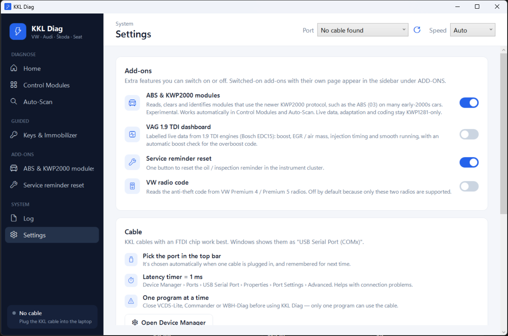

# KKL Diag

A free, simple Windows app for diagnosing older VW-group cars (VW, Audi, Seat, Škoda, roughly 1994–2005) with a cheap **KKL / VAG-COM 409.1 USB cable**.

It is a friendly front-end for [KW1281Test](https://github.com/gmenounos/kw1281test) by gmenounos, which does all the talking to the car. KKL Diag adds menus, plain-English results and step-by-step guides on top.



| Control modules | Key programming |
|---|---|
|  |  |



## What it can do

- **Auto-Scan**: read fault codes from every module in one go, with names and a Ross-Tech wiki link for each code.
- **Control modules**: per module, read and clear fault codes, read ident, live data (measuring blocks), adaptation, basic settings, output tests and coding.
- **Keys & immobilizer**: a guided wizard to program keys (adaptation channel 21), including reading the PIN from many VDO / Magneti Marelli clusters.
- **Add-ons**, each switchable on or off in Settings:
  - **ABS & KWP2000 modules** (experimental): fault codes for modules that answer with KWP2000 instead of KWP1281, such as some ABS units.
  - **VAG 1.9 TDI dashboard**: labelled live data for boost, EGR / air mass, injection timing and smooth running on EDC15 TDI engines.
  - **Service reminder reset** for clusters of the Golf 4 / Octavia 1U / Passat B5 generation.
  - **VW radio code** for VW Premium 4 (Clarion) and Premium 5 (Delco) radios.

## Which cars work

Cars that use the **K-line with the VAG KWP1281 protocol**: most VW, Audi, Seat and Škoda models from about 1994 to 2005 (Golf 3/4, Bora, Passat B5, Polo 6N, Octavia 1U, Fabia 6Y, Leon/Toledo 1M, A3 8L, A4 B5/B6, A6 C5 and similar).

Not supported:
- **CAN-bus-only cars** (most VAG cars from about 2005 on). A KKL cable can't talk to those.
- **Other brands.** KW1281Test only speaks the VAG protocols, not generic OBD-II.

## Getting started

1. Download `KKL Diag.exe` from the [Releases](../../releases) page, or build it yourself (see below).
2. Download `kw1281test.exe` from the [KW1281Test releases](https://github.com/gmenounos/kw1281test/releases) and put it in a `kw1281test` folder next to `KKL Diag.exe`.
3. Optional: put the KWP2000 add-on build in `addons\kwp2000\kw1281test.exe` (see below).
4. Plug the cable in, turn the ignition ON and start `KKL Diag.exe`. The cable is detected automatically.

Folder layout:

```
KKL Diag.exe
kw1281test\kw1281test.exe
addons\kwp2000\kw1281test.exe   (optional)
```

Cable tips: FTDI-based KKL cables work best. Setting the COM port latency timer to 1 ms (Device Manager › Ports › Properties › Port Settings › Advanced) helps with flaky connections. Close other diagnostic programs first; only one program can use the cable at a time.

## Building

Requires only Windows 10/11 (.NET Framework 4.8 and its C# compiler ship with Windows):

```
powershell -ExecutionPolicy Bypass -File src\build.ps1
```

KWP2000 add-on (needs git and the [.NET 10 SDK](https://dotnet.microsoft.com/download)). This clones KW1281Test, applies `addons-src\kwp2000.patch` and publishes to `addons\kwp2000`:

```
powershell -ExecutionPolicy Bypass -File addons-src\build-kwp2000.ps1
```

## Privacy

The app writes `settings.ini` and a `logs` folder next to itself. Logs and EEPROM dumps (from reading the immobilizer PIN) contain your **VIN and immobilizer data**. `.gitignore` excludes them; don't attach EEPROM dumps to public issues.

## Contributing

Bug reports with the log (Log page › Copy) are very welcome, especially from cars and modules that don't work yet. Remove the VIN from the log before posting.

## Disclaimer

Use at your own risk. Changing coding, adaptation or immobilizer settings can make a module or the car stop working. Write down original values before changing anything. This project is not affiliated with Ross-Tech, VW, Audi, Seat or Škoda.

## License

MIT, see [LICENSE](LICENSE). KW1281Test is MIT-licensed by gmenounos; `addons-src\kwp2000.patch` is a modification of it under the same license.
